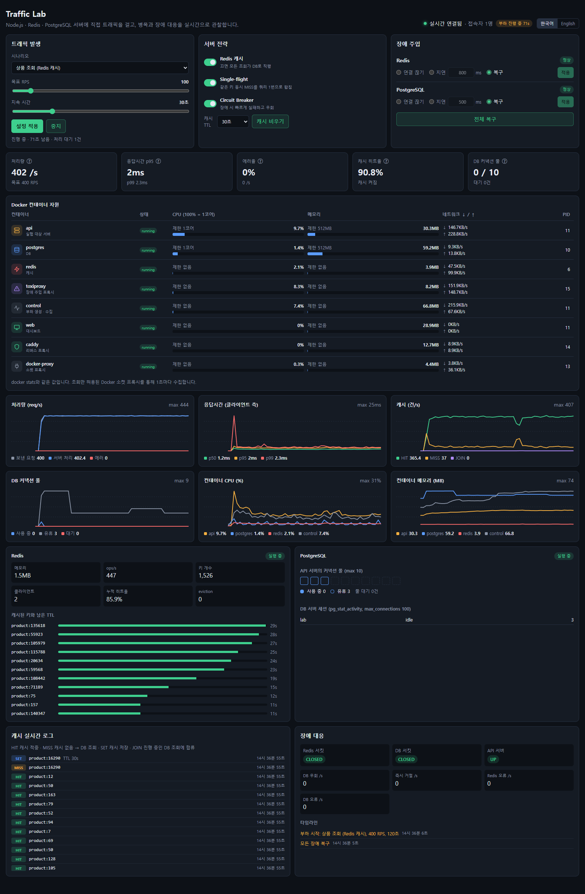
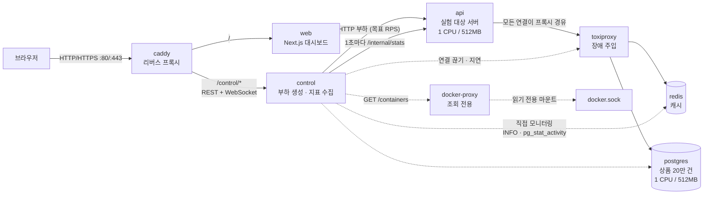
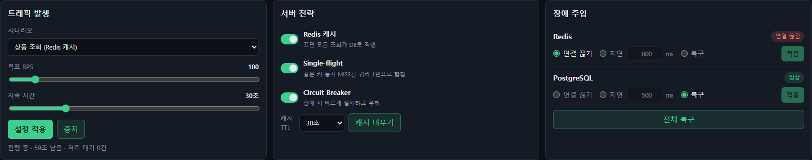
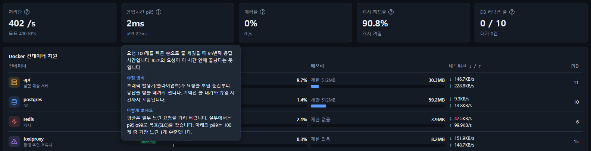
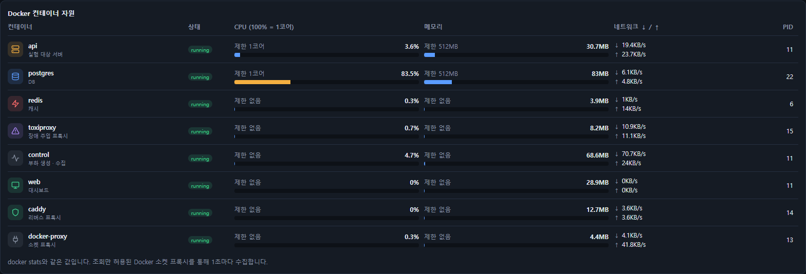
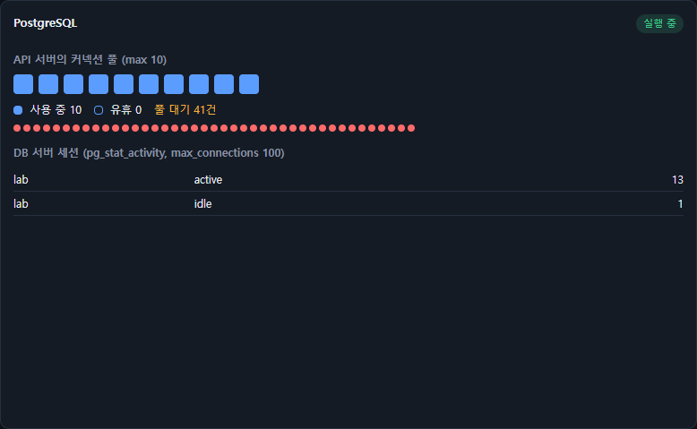
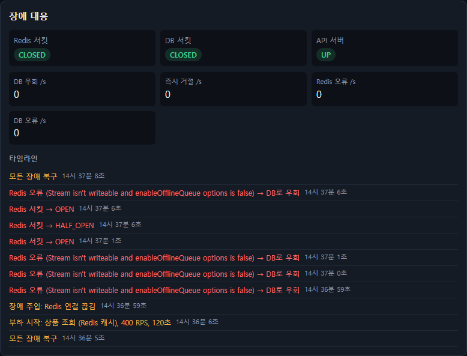
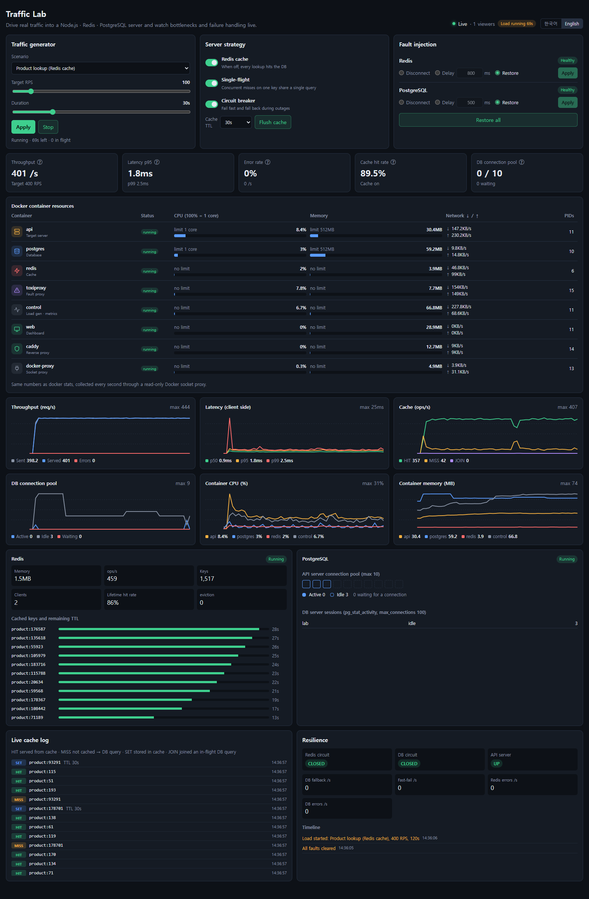

# Traffic Lab — visualizer-high-traffic

Node.js · Redis · PostgreSQL 서버에 **직접 트래픽을 걸고**, 캐시 · DB 커넥션 풀 · 장애 대응이 어떻게 동작하는지 **브라우저에서 실시간으로 관찰**하는 실험실입니다.

대규모 트래픽을 실무에서 겪어보지 않아도, 부하를 올려 서버를 한계까지 몰아붙이고 → 병목을 눈으로 확인하고 → 전략을 바꿔 개선되는 과정을 숫자로 체험할 수 있습니다.



<p align="center"><sub>상품 조회 400 RPS · 캐시 히트율 90.8% · p95 2ms 상태의 대시보드</sub></p>

---

## 목차

1. [주요 기능](#주요-기능)
2. [사전 준비 (필수 설치 항목)](#사전-준비-필수-설치-항목)
3. [빠른 시작](#빠른-시작)
4. [실행 · 종료 · 초기화 명령어](#실행--종료--초기화-명령어)
5. [아키텍처](#아키텍처)
6. [프로젝트 구조](#프로젝트-구조)
7. [서비스별 역할](#서비스별-역할)
8. [사용 기술](#사용-기술)
9. [대시보드 사용법](#대시보드-사용법)
10. [추천 실험](#추천-실험)
11. [환경 변수](#환경-변수)
12. [Control API](#control-api)
13. [서버에 공개 배포하기](#서버에-공개-배포하기)
14. [공개 데모 안전장치](#공개-데모-안전장치)
15. [트러블슈팅](#트러블슈팅)
16. [측정 시 주의할 점](#측정-시-주의할-점)

---

## 주요 기능

| 기능 | 설명 |
|---|---|
| **트래픽 발생** | 목표 RPS(초당 요청 수)와 지속 시간을 슬라이더로 조절해 실제 HTTP 부하를 발생 |
| **시나리오 선택** | 캐시 조회 / 인덱스 조회 / 풀스캔 검색 / 느린 쿼리 / 혼합 / 커스텀 SQL |
| **서버 전략 토글** | Redis 캐시, Single-flight(스탬피드 방지), Circuit Breaker를 실행 중에 켜고 끄기 |
| **장애 주입** | Redis · PostgreSQL 연결 끊기, 원하는 ms만큼 응답 지연 — 적용 버튼으로 반영 |
| **실시간 지표** | 처리량, p50/p95/p99 응답시간, 에러율, 캐시 HIT/MISS, DB 커넥션 풀 사용·대기 |
| **컨테이너 자원** | 컨테이너별 CPU · 메모리 · 네트워크 · PID (`docker stats`와 동일한 값) |
| **캐시 시각화** | HIT/MISS/SET 실시간 로그, 캐시된 키와 남은 TTL 막대 |
| **장애 대응 시각화** | 서킷 상태(CLOSED → OPEN → HALF_OPEN), DB 우회·즉시 거절 수, 이벤트 타임라인 |
| **다국어** | 한국어 / English 전환 |
| **공유 실험실** | 모든 방문자가 같은 서버를 공유 — 누군가 장애를 넣으면 모두의 화면에 반영 |

---

## 사전 준비 (필수 설치 항목)

모든 서비스(서버, DB, Redis, 프론트엔드)가 Docker 컨테이너로 실행되므로 **Node.js나 DB를 따로 설치할 필요가 없습니다.**

### 필수

| 항목 | 최소 버전 | 확인 명령어 | 비고 |
|---|---|---|---|
| **Docker Desktop** (Windows / macOS) | **4.20 이상** | `docker --version` | Windows는 WSL2 백엔드 사용 |
| 또는 **Docker Engine** (Linux) | **24.0 이상** | `docker --version` | |
| **Docker Compose v2** | **2.20 이상** | `docker compose version` | `docker-compose`(v1, 하이픈)가 아닌 `docker compose` 명령 |
| **Git** | 2.x | `git --version` | 저장소 복제용 |

> 개발·검증 환경: Docker 28.4.0, Docker Compose v2.39.2, Windows 11 (WSL2)

### 시스템 요구사항

| 항목 | 권장 |
|---|---|
| Docker에 할당된 CPU | **2코어 이상** (api·postgres가 각각 1코어로 제한되어 있음) |
| Docker에 할당된 메모리 | **4GB 이상** |
| 디스크 여유 공간 | 약 2GB (이미지 + DB 데이터) |
| 사용 가능한 포트 | **80** (HTTP), **443** (HTTPS, 도메인 배포 시) |
| 브라우저 | 최신 Chrome · Edge · Firefox · Safari |
| 인터넷 | 최초 실행 시 Docker 이미지·npm 패키지 다운로드에 필요 |

### 선택

| 항목 | 버전 | 필요한 경우 |
|---|---|---|
| Node.js | 20 이상 | Docker 없이 개별 서비스를 직접 실행·수정하고 싶을 때만 |

---

## 빠른 시작

```bash
# 1. 저장소 복제
git clone https://github.com/Mithpasong/visualizer-high-traffic.git
cd visualizer-high-traffic

# 2. (선택) 환경 변수 파일 생성 — 기본값으로도 실행됩니다
cp .env.example .env

# 3. 빌드 및 실행 (최초 1회는 이미지 빌드로 수 분 걸립니다)
docker compose up -d --build

# 4. 상태 확인 — 8개 컨테이너가 모두 Up 이면 정상
docker compose ps
```

브라우저에서 **http://localhost** 를 열면 대시보드가 나타납니다. 오른쪽 위에 **"실시간 연결됨"** 초록 점이 보이면 준비 완료입니다.

> 최초 실행 시 PostgreSQL이 상품 데이터 **20만 건**을 자동으로 생성합니다(수 초 소요).

---

## 실행 · 종료 · 초기화 명령어

프로젝트 폴더에서 실행합니다. **자동 재시작 설정이 없으므로** PC를 재부팅해도 저절로 켜지지 않고, 아래 명령어로 직접 실행해야 합니다.

| 목적 | 명령어 | 설명 |
|---|---|---|
| 실행 | `docker compose up -d` | 백그라운드 실행 |
| 실행 (로그 보면서) | `docker compose up` | `Ctrl + C`로 종료 |
| 코드 수정 후 재실행 | `docker compose up -d --build` | 변경된 서비스 이미지를 다시 빌드 |
| 특정 서비스만 재빌드 | `docker compose up -d --build web` | 예: 프론트엔드만 |
| 상태 확인 | `docker compose ps` | |
| 로그 보기 | `docker compose logs -f api` | 서비스 이름: `api` `control` `web` `postgres` `redis` … |
| 일시 정지 | `docker compose stop` | 컨테이너 유지, `start`로 재개 |
| 종료 | `docker compose down` | 컨테이너 삭제, **DB 데이터는 유지** |
| 완전 초기화 | `docker compose down -v` | DB 데이터까지 삭제, 다음 실행 시 20만 건 재생성 |

DB·Redis에 직접 접속하려면 (외부 포트는 열려 있지 않습니다):

```bash
docker compose exec postgres psql -U lab -d lab
docker compose exec redis redis-cli
```

---

## 아키텍처



### 요청 흐름

1. 사용자가 대시보드에서 **부하 시작**을 누르면 `control`이 목표 RPS에 맞춰 `api`로 HTTP 요청을 보냅니다.
2. `api`는 Redis 캐시를 먼저 확인하고(캐시 어사이드), 없으면 PostgreSQL에서 조회한 뒤 캐시에 저장합니다.
3. `api` → Redis/PostgreSQL 연결은 모두 **toxiproxy를 거칩니다.** 장애 주입은 실제 DB를 죽이는 대신 이 프록시에서 연결을 끊거나 지연시킵니다.

### 지표 흐름

1. `control`이 **1초마다** 아래를 동시에 수집합니다.
   - `api` 내부 지표: 처리량, 응답시간, 캐시 HIT/MISS, 커넥션 풀, 서킷 상태, 이벤트
   - Redis `INFO`, 캐시 키와 TTL (toxiproxy를 거치지 않고 직접 접속 → 장애 중에도 실제 상태 확인)
   - PostgreSQL `pg_stat_activity`
   - toxiproxy 프록시 상태
   - 컨테이너 자원 (docker-proxy 경유)
2. 하나의 스냅샷으로 묶어 **WebSocket으로 모든 접속자에게 브로드캐스트**합니다.
3. 대시보드는 최근 60초를 차트로 그립니다.

---

## 프로젝트 구조

```
visualizer-high-traffic/
├── docker-compose.yml        # 전체 서비스 정의 (8개 컨테이너, 자원 제한)
├── .env.example              # 환경 변수 예시
├── .gitattributes            # 줄바꿈 LF 고정 (Windows에서 커밋해도 Linux에서 정상 동작)
│
├── api/                      # 실험 대상 서버
│   ├── Dockerfile
│   ├── package.json
│   └── src/server.js         # 캐시 어사이드, single-flight, 서킷 브레이커, 커넥션 풀, 지표 집계
│
├── control/                  # 부하 생성기 + 지표 수집 + 장애 주입
│   ├── Dockerfile
│   ├── package.json
│   └── src/
│       ├── server.js         # REST API, WebSocket 브로드캐스트, Redis/PG/toxiproxy/Docker 수집
│       └── loadgen.js        # 목표 RPS 부하 생성기, 시나리오 정의
│
├── web/                      # Next.js 대시보드 (프론트엔드)
│   ├── Dockerfile
│   ├── next.config.mjs
│   ├── app/
│   │   ├── layout.jsx
│   │   ├── page.jsx          # 화면 배치 (조작 카드 → KPI → 컨테이너 → 차트 → 패널)
│   │   └── globals.css       # 다크 테마 스타일, 반응형
│   ├── components/
│   │   ├── Controls.jsx      # 트래픽 발생 · 서버 전략 · 장애 주입 카드
│   │   ├── Panels.jsx        # KPI, 컨테이너, Redis, PostgreSQL, 캐시 로그, 장애 대응 패널
│   │   ├── LineChart.jsx     # 의존성 없는 SVG 실시간 차트
│   │   └── ServiceIcon.jsx   # 컨테이너별 아이콘
│   └── lib/
│       ├── lab.js            # WebSocket 연결, 스냅샷 → 차트 데이터 변환, 포맷 함수
│       └── i18n.jsx          # 한국어/영어 번역 사전, 언어 전환
│
├── infra/
│   ├── Caddyfile             # 리버스 프록시 라우팅, 도메인 설정 시 자동 HTTPS
│   ├── init.sql              # 상품 테이블 + 20만 건 시드, 인덱스, 읽기 전용 계정
│   └── toxiproxy.json        # Redis/PostgreSQL 프록시 정의
│
└── docs/images/              # README 스크린샷
```

---

## 서비스별 역할

| 서비스 | 이미지 / 기술 | 자원 제한 | 외부 노출 | 역할 |
|---|---|---|---|---|
| **caddy** | `caddy:2.8-alpine` | 없음 | **80, 443** | 유일한 외부 입구. `/` → web, `/control/*` → control. 도메인 지정 시 HTTPS 인증서 자동 발급 |
| **web** | Next.js 14 (Node 20) | 없음 | ✕ | 대시보드 UI. WebSocket으로 1초마다 스냅샷을 받아 화면 갱신 |
| **control** | Node 20 · Fastify | 없음 | ✕ (caddy 경유) | 부하 생성, 지표 수집·브로드캐스트, 장애 주입, 서버 설정 변경 중계 |
| **api** | Node 20 · Fastify | **CPU 1코어 · 512MB** | ✕ | **실험 대상.** 캐시 어사이드, single-flight, 서킷 브레이커, pg 커넥션 풀(기본 10) |
| **toxiproxy** | `shopify/toxiproxy:2.9.0` | 없음 | ✕ | api와 Redis/PostgreSQL 사이의 TCP 프록시. 연결 차단·지연 주입 |
| **redis** | `redis:7-alpine` | 메모리 128MB (LRU) | ✕ | 캐시. 디스크 저장 없음 |
| **postgres** | `postgres:16-alpine` | **CPU 1코어 · 512MB** | ✕ | 상품 20만 건. 볼륨에 데이터 보관 |
| **docker-proxy** | `tecnativa/docker-socket-proxy:0.3.0` | 없음 | ✕ | 컨테이너 자원 조회 전용. Docker 소켓을 직접 노출하지 않고 GET만 허용 |

> api와 postgres에 일부러 자원 제한을 걸어, 일반 PC에서도 병목이 빨리 드러나도록 했습니다.

### api 서버 엔드포인트 (내부용)

| 경로 | 동작 |
|---|---|
| `GET /products/:id` | 캐시 어사이드 조회 (Redis → 없으면 PostgreSQL → Redis 저장) |
| `GET /category/:category` | 인덱스를 타는 카테고리 조회 (`category, price` 복합 인덱스) |
| `GET /search?q=` | 인덱스 없는 `LIKE '%…%'` 풀스캔 |
| `GET /slow` | `pg_sleep(0.2)` — 커넥션을 200ms 점유 |
| `POST /query/custom` | 읽기 전용 계정으로 커스텀 SQL 실행 (2초 타임아웃) |
| `GET /internal/stats` | 1초 윈도우 지표 + 이벤트 (control 전용) |
| `POST /internal/config` | 캐시·single-flight·서킷·TTL 설정 변경 (control 전용) |

---

## 사용 기술

| 영역 | 기술 | 버전 |
|---|---|---|
| 런타임 | Node.js | 20 (alpine) |
| API 서버 | Fastify | 4.x |
| Redis 클라이언트 | ioredis | 5.x |
| PostgreSQL 클라이언트 | node-postgres (pg) | 8.x |
| 서킷 브레이커 | opossum | 8.x |
| 부하 생성 HTTP 클라이언트 | undici | 6.x |
| WebSocket | ws | 8.x |
| 프론트엔드 | Next.js / React | 14.2 / 18.3 |
| 캐시 | Redis | 7 |
| 데이터베이스 | PostgreSQL | 16 |
| 장애 주입 | Toxiproxy | 2.9 |
| 리버스 프록시 | Caddy | 2.8 |
| 컨테이너 | Docker Compose | v2 |

---

## 대시보드 사용법

### 1. 조작 카드



| 카드 | 사용법 |
|---|---|
| **트래픽 발생** | 시나리오 선택 → 목표 RPS · 지속 시간 조절 → **부하 시작**. 실행 중에 슬라이더를 움직이면 바로 반영됩니다. |
| **서버 전략** | Redis 캐시 / Single-flight / Circuit Breaker를 켜고 끄기, 캐시 TTL 변경, 캐시 비우기 |
| **장애 주입** | Redis · PostgreSQL 각각 **연결 끊기 / 지연(ms 직접 입력) / 복구** 중 선택 → **적용**. 위 화면은 Redis 연결을 끊은 상태입니다. |

#### 시나리오

| 시나리오 | 요청 | 관찰 포인트 |
|---|---|---|
| 상품 조회 (Redis 캐시) | 90%가 인기 상품 200개에 집중 | 캐시 히트율, TTL 만료, 캐시 장애 시 DB 우회 |
| 카테고리 조회 (인덱스 O) | 복합 인덱스 조회 | 빠른 쿼리의 기준선 |
| 설명 검색 (인덱스 X) | `LIKE '%abc123%'` 풀스캔 | DB CPU 병목, 커넥션 풀 고갈 |
| 느린 쿼리 | `pg_sleep(0.2)` | 낮은 RPS로도 풀이 가득 차는 현상 |
| 혼합 | 조회 70 / 카테고리 20 / 검색 10 | 실제 서비스에 가까운 혼합 부하 |
| 커스텀 SQL | 직접 입력한 SQL | `ADMIN_TOKEN` 설정 시에만 활성화 |

### 2. KPI 카드

카드에 마우스를 올리면 **의미 · 측정 방식 · 보는 법**이 툴팁으로 나옵니다.



| 지표 | 의미 |
|---|---|
| 처리량 | API 서버가 실제로 처리한 요청 수/초. 목표 RPS를 올려도 더 안 오르는 지점이 서버의 한계 |
| 응답시간 p95 | 95%의 요청이 이 시간 안에 끝남. 커넥션 풀 대기·큐잉 시간까지 포함한 클라이언트 측 값 |
| 에러율 | 4xx/5xx, 5초 타임아웃, 연결 실패 비율 |
| 캐시 히트율 | Redis에서 바로 응답한 비율 |
| DB 커넥션 풀 | 사용 중 / 최대, 대기 중인 요청 수 |

### 3. Docker 컨테이너 자원

`docker stats`와 같은 값을 1초마다 보여줍니다. CPU는 **100% = 1코어** 기준이며, 막대는 **할당된 한도 대비** 사용량입니다.



<p align="center"><sub>인덱스 없는 검색 100 RPS: api는 3.6%로 한가하지만 postgres가 1코어 한도에 가깝게 사용 중 → 병목은 DB</sub></p>

### 4. 실시간 차트 (최근 60초)

처리량(보낸 요청 vs 서버 처리 vs 에러), 응답시간(p50/p95/p99), 캐시(HIT/MISS/JOIN), DB 커넥션 풀(사용/유휴/대기), 컨테이너 CPU, 컨테이너 메모리.

### 5. Redis · PostgreSQL 패널

- **Redis**: 메모리, ops/s, 키 개수, 누적 히트율, eviction, 캐시된 키와 **남은 TTL 막대**
- **PostgreSQL**: API 서버 커넥션 풀 10칸(사용 중/유휴), **대기 중인 요청 점**, DB 서버 세션(`pg_stat_activity`)



<p align="center"><sub>풀 10개가 모두 사용 중이고 41건이 커넥션을 기다리는 상태</sub></p>

### 6. 캐시 로그 · 장애 대응

- **캐시 실시간 로그**: `HIT` 캐시 적중, `MISS` DB 조회, `SET` 캐시 저장, `JOIN` 진행 중인 DB 조회에 합류(single-flight)
- **장애 대응**: Redis/DB 서킷 상태, 초당 DB 우회·즉시 거절·오류 수, 이벤트 타임라인



<p align="center"><sub>Redis 연결 끊김 → 오류 발생 시 DB로 우회 → 서킷 OPEN → HALF_OPEN 시험 → 복구</sub></p>

### 7. 언어 전환

오른쪽 위 **한국어 | English** 버튼으로 전환합니다. 선택은 브라우저에 저장됩니다.

<details>
<summary>English 화면 보기</summary>



</details>

---

## 추천 실험

| # | 실험 | 방법 | 관찰할 것 |
|---|---|---|---|
| 1 | **캐시의 효과** | 상품 조회 500 RPS → 서버 전략에서 **Redis 캐시 끄기** → PostgreSQL **지연 500ms** 적용 | 캐시가 꺼진 순간 커넥션 풀이 차고 대기·p95가 급증. 캐시가 무엇을 막아주는지 확인 |
| 2 | **캐시 스탬피드** | Single-flight 끄기 → **캐시 비우기** | MISS가 한꺼번에 DB로 몰림. Single-flight를 켜면 `JOIN`으로 합쳐짐 |
| 3 | **Redis 장애** | 상품 조회 300 RPS 중 Redis **연결 끊기** | 에러 없이 DB로 우회 → 서킷 OPEN. 복구 후 약 5초 뒤 HALF_OPEN → CLOSED |
| 4 | **DB 장애와 캐시** | 상품 조회 중 PostgreSQL **연결 끊기** | 캐시에 있는 상품은 계속 응답, MISS만 실패. 카테고리 조회로 하면 100% 실패 |
| 5 | **빠른 실패** | 실험 4를 Circuit Breaker **끄고** 반복 | 서킷이 없으면 연결 시도로 2초씩 묶여 p95 급등, 풀 대기 증가 |
| 6 | **커넥션 풀 고갈** | 느린 쿼리 100 RPS | 풀 10개가 가득 차고 대기열이 쌓임 (100 RPS × 0.2초 = 20개 필요) |
| 7 | **인덱스의 효과** | 카테고리 조회 vs 설명 검색을 같은 RPS로 비교 | 인덱스 없는 검색은 postgres CPU 100%, p95 수 초 |
| 8 | **서버의 한계 찾기** | 목표 RPS를 단계적으로 올리기 | 처리량이 더 이상 따라 오르지 않고 p95가 꺾여 오르는 지점 |

> 💡 **동시 커넥션 수 ≈ 초당 요청 수 × 요청 하나의 커넥션 점유 시간** (리틀의 법칙).
> PK 조회(1000 RPS × 0.5ms ≈ 0.5개)로는 풀이 거의 차지 않고, 느린 쿼리(100 RPS × 2초 = 200개)는 바로 고갈됩니다.

---

## 환경 변수

`.env.example`을 `.env`로 복사해서 수정합니다. 모두 선택 사항이며, 비워 두면 기본값이 쓰입니다.

| 변수 | 기본값 | 설명 |
|---|---|---|
| `SITE_ADDRESS` | `:80` | 도메인(예: `lab.example.com`)을 넣으면 Caddy가 HTTPS 인증서를 자동 발급 |
| `MAX_RPS` | `1000` | 목표 RPS 상한 |
| `MAX_DURATION_SEC` | `120` | 부하 최대 지속 시간(초) |
| `ADMIN_TOKEN` | (없음) | 설정하면 **커스텀 SQL** 시나리오가 활성화되고, 이 토큰을 입력해야 실행 가능 |
| `DB_POOL_MAX` | `10` | api 서버의 DB 커넥션 풀 크기 |

변경 후에는 `docker compose up -d`로 다시 적용합니다.

---

## Control API

대시보드가 사용하는 API입니다. `curl`로 직접 호출해 실험을 자동화할 수 있습니다. (경로 앞에 `/control`)

| 메서드 · 경로 | 본문 예시 | 설명 |
|---|---|---|
| `GET /control/state` | | 최신 스냅샷 (JSON) |
| `WS /control/ws` | | 1초마다 스냅샷 푸시 |
| `POST /control/load/start` | `{"scenario":"product","rps":300,"durationSec":30}` | 부하 시작 / 실행 중이면 설정 변경 |
| `POST /control/load/stop` | `{}` | 부하 중지 |
| `POST /control/config` | `{"cacheEnabled":false,"cacheTtlSec":10}` | 서버 전략 변경 |
| `POST /control/cache/flush` | `{}` | Redis 캐시 전체 삭제 |
| `POST /control/chaos` | `{"target":"redis","action":"down"}` | `action`: `down` · `latency`(+`ms`) · `up` · `reset` |

```bash
# 예: 상품 조회 300 RPS로 30초 부하 후, PostgreSQL에 300ms 지연 주입
curl -X POST http://localhost/control/load/start -H 'content-type: application/json' \
  -d '{"scenario":"product","rps":300,"durationSec":30}'
curl -X POST http://localhost/control/chaos -H 'content-type: application/json' \
  -d '{"target":"postgres","action":"latency","ms":300}'
```

---

## 서버에 공개 배포하기

클라우드 VM 1대에 그대로 올리면 됩니다. (Vercel 같은 서버리스 플랫폼은 Redis·PostgreSQL 상주와 WebSocket 유지가 어려워 맞지 않습니다.)

1. **VM 준비** — Ubuntu 22.04 이상, **2 vCPU / 4GB RAM 이상** 권장 (AWS Lightsail · EC2, GCP, Hetzner, Oracle Cloud 등)
2. **Docker 설치** — [공식 설치 가이드](https://docs.docker.com/engine/install/ubuntu/)
3. **도메인 연결** — 도메인 A 레코드를 VM IP로 지정, 방화벽에서 **80 · 443** 개방
4. **실행**
   ```bash
   git clone https://github.com/Mithpasong/visualizer-high-traffic.git
   cd visualizer-high-traffic
   cp .env.example .env
   # .env 편집: SITE_ADDRESS=lab.example.com, ADMIN_TOKEN=<임의의 긴 문자열>
   docker compose up -d --build
   ```
5. `https://lab.example.com` 접속 — 인증서는 Caddy가 자동 발급·갱신합니다.

> 서버 재부팅 후에도 데모가 살아 있어야 한다면, `docker-compose.yml`의 각 서비스에 `restart: unless-stopped`를 추가하세요.

---

## 공개 데모 안전장치

| 위험 | 대응 |
|---|---|
| 과도한 부하 | `MAX_RPS` · `MAX_DURATION_SEC` 상한, 부하는 서버 전체에서 한 번에 하나, 응답 대기 1000건 초과 시 발생기가 자체 제한 |
| 조작 남용 | IP당 조작 요청 300ms 간격 제한 |
| 임의 SQL 실행 | 관리자 토큰 필수, 읽기 전용 role(`default_transaction_read_only`), `statement_timeout 2s` |
| 내부 서비스 노출 | api · DB · Redis · toxiproxy · docker-proxy 포트 비공개, Caddy 80/443만 공개 |
| Docker 소켓 | 직접 마운트하지 않고 **조회(GET)만 허용하는 소켓 프록시** 경유 |

---

## 트러블슈팅

| 증상 | 원인 · 해결 |
|---|---|
| `http://localhost` 접속 불가 | `docker compose ps`로 8개 컨테이너가 모두 `Up`인지 확인. 일부만 떠 있으면 `docker compose up -d` 재실행 |
| `port is already allocated` (80/443) | 다른 프로그램(IIS, Apache, 다른 컨테이너)이 포트 사용 중. 종료하거나 `docker-compose.yml`의 caddy `ports`를 `"8080:80"`처럼 변경 후 `http://localhost:8080` |
| 화면에 "연결 중…"만 표시 | control 컨테이너 확인: `docker compose logs control` |
| 컨테이너 자원에 "Docker 정보를 읽을 수 없습니다" | docker-proxy 상태 확인: `docker compose logs docker-proxy`. Docker Desktop에서 기본 소켓(`/var/run/docker.sock`) 사용이 켜져 있는지 확인 |
| `init.sql`을 고쳤는데 반영 안 됨 | 시드 스크립트는 DB 볼륨이 비어 있을 때만 실행됩니다. `docker compose down -v` 후 재실행 |
| 코드를 고쳤는데 화면이 그대로 | `docker compose up -d --build` 로 재빌드 |
| 처음 실행 직후 502 응답 | 서비스가 뜨는 중입니다. 수 초 후 새로고침 |
| 커스텀 SQL을 선택할 수 없음 | `.env`에 `ADMIN_TOKEN`을 설정해야 활성화됩니다 |

---

## 측정 시 주의할 점

- **부하 발생기(control)와 대상 서버가 같은 머신**에서 동작합니다. RPS를 높이면 발생기도 CPU를 쓰므로, 절대 수치는 참고용입니다. 정밀 측정이 필요하면 control을 별도 머신으로 분리하세요.
- Windows / macOS의 Docker Desktop은 가상머신 위에서 동작하므로, 같은 설정이라도 Linux 서버보다 수치가 낮게 나올 수 있습니다.
- 대시보드의 커넥션 풀 수치는 **1초마다 찍는 순간값**입니다. 1ms 미만으로 끝나는 쿼리는 실제로 많이 실행되어도 0에 가깝게 보일 수 있습니다.
- 모든 방문자가 **같은 서버를 공유**합니다. 다른 사람이 건 부하나 장애가 내 화면에도 반영됩니다.

---

## License

[MIT](LICENSE) © 2026 Mithpasong
